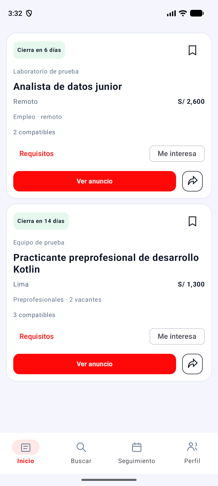
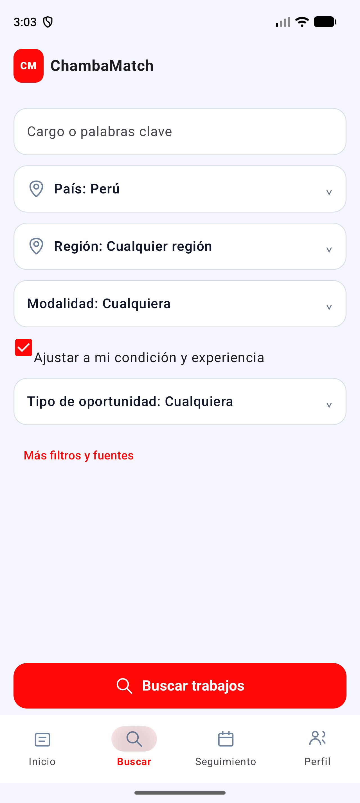

# ChambaMatch Android — empleos que encajan con tu perfil

Aplicación autónoma en **Kotlin y Jetpack Compose** para buscar empleos, comparar requisitos con tu experiencia y organizar postulaciones. Funciona en **Android 8 o posterior**, con tu perfil y aprendizaje guardados en el celular.

**Versión 2.8.0 · Android job finder · job matching · employment tracker**

[Descargar APK 2.8.0](https://github.com/HEYLER1/chambamatch-android/raw/refs/heads/main/apk/ChambaMatch-2.8.0.apk) · [Guía completa](docs/GUIA.md) · [Investigación y referencias](REFERENCIAS.md)

## Qué puedes hacer

- Seleccionar entre **250 países y territorios**, incluido Brasil, sus regiones o **Cualquier región**; también elegir Todo el mundo y modalidad remota.
- Consultar anuncios públicos de **LinkedIn**, **Prácticas.pe** y **Convocatorias de Trabajo**, o añadir una descripción manualmente. Los dos portales peruanos mantienen su cobertura local.
- Comparar los requisitos detectados en la descripción con tu carrera, condición académica, habilidades, experiencia e idiomas, conservando la frase del anuncio como evidencia.
- Distinguir requisitos obligatorios y deseables, brechas y datos pendientes de confirmar. Las valoraciones ajustan el orden mediante aprendizaje local sin superar los filtros ni las brechas obligatorias.
- Marcar **Me interesa**, guardar ofertas y verlas en **Seguimiento**, ordenadas por cierre, incluso después de cambiar los filtros o el país.
- Organizar cada postulación como Pendiente, Preparando, Postulada o Descartada; revisar los días restantes y marcar qué requisitos tienes preparados.
- Volver a consultar las fuentes para revisar fechas y descripciones. Exportar y restaurar una copia con perfil, ofertas, valoraciones y seguimiento.

## Interfaz

Inicio muestra directamente las ofertas semejantes a tu perfil, sin cabeceras, contadores ni botón Actualizar. Desliza de arriba hacia abajo para recargar. Buscar contiene únicamente los filtros, con su botón siempre visible. Las tarjetas compactas resumen ubicación, sueldo, cierre y afinidad; Requisitos despliega la evaluación, la descripción y los cuatro bloques completos. Seguimiento conserva las fechas y el avance de postulación.

| Inicio: recomendaciones | Buscar: filtros |
| --- | --- |
|  |  |

Las ofertas de la captura de Inicio son ficticias y se utilizan exclusivamente en pruebas.

## Instalar y empezar

1. Descarga la [APK de prueba 2.5.0](https://github.com/HEYLER1/chambamatch-android/raw/refs/heads/main/apk/ChambaMatch-2.8.0.apk) e instálala. Si ya usas ChambaMatch, instala encima **sin desinstalar** para conservar tus datos.
2. En **Perfil**, completa tu información real: carrera, habilidades y experiencia. Puedes escribir una duración clara, como «Tengo seis meses de experiencia», o indicar tus meses totales.
3. En **Buscar**, selecciona país, región, modalidad, cargo y tipo de oportunidad. Pulsa **Buscar trabajos**.
4. Revisa en **Inicio** la evidencia de requisitos. **Me interesa** o el marcador incorporan la oferta a **Seguimiento**.
5. En **Seguimiento**, prepara los requisitos, organiza el estado y revisa los cierres. **Revisar fechas en las fuentes** consulta las ofertas seleccionadas y conserva los datos anteriores si falla una fuente.

El perfil, el análisis, las valoraciones y la agenda funcionan sin computadora ni servidor. Internet permite consultar nuevos anuncios, revisar fuentes y abrir enlaces originales.

## Evaluación y cobertura

La compatibilidad es orientativa y utiliza reglas de extracción y una regresión logística local, sin un modelo semántico preentrenado. No reconoce exhaustivamente todos los requisitos o idiomas. Mencionar una habilidad no demuestra un nivel avanzado, una certificación o experiencia específica. Las condiciones desconocidas se muestran pendientes; marcar un requisito como preparado no cambia la evaluación del perfil.

Los listados públicos tienen cobertura parcial y pueden cambiar o bloquear la lectura. Seleccionar un país no garantiza anuncios en él. LinkedIn puede omitir descripciones o fechas: la app informa la falta de evidencia. Revisa el anuncio y las bases antes de postular.

## Desarrollo y pruebas

Abre la raíz del repositorio en Android Studio. Usa JDK 17, Android SDK 37 y Build Tools 36.0.0. El proyecto fija AGP 9.4.1, Gradle 9.6.0 y compilador Compose 2.2.10. Incluye Gradle Wrapper.

```sh
./gradlew assembleDebug testDebugUnitTest lintDebug
```

Con un dispositivo o emulador abierto:

```sh
./gradlew connectedDebugAndroidTest
```

Las consultas reales son optativas:

```sh
./gradlew connectedDebugAndroidTest -Pandroid.testInstrumentationRunnerArguments.liveSources=true
```

Validación del motor de 2.5.0 el 6 de octubre de 2026: **47 pruebas unitarias y 13 instrumentadas locales aprobadas**, compilación y lint aprobados en Android 17. Las cuatro pruebas optativas de red se omitieron en esa validación. Se probaron requisitos, brechas obligatorias, deseables, seguimiento fuera de filtros, fechas, actualización de descripciones, bloqueo sin pérdida de datos, aprendizaje reversible y copias de seguridad.

El APK generado está en `app/build/outputs/apk/debug/app-debug.apk`. La APK incluida en `apk/` utiliza firma de prueba y conserva el identificador `pe.chambamatch` para actualizar las versiones anteriores.

## Datos y licencias

Los datos personales se guardan en el almacenamiento privado del celular. Las copias personales, claves de firma, archivos de configuración local y resultados de compilación quedan fuera del repositorio. El APK contiene el catálogo geográfico, no tu perfil ni tus ofertas personales.

Código bajo [Apache License 2.0](LICENSE). El catálogo derivado de [Countries States Cities Database](https://github.com/dr5hn/countries-states-cities-database) incluye 250 países y territorios y 5.317 nombres de regiones, bajo **ODbL 1.0**; su [licencia](app/src/main/assets/world-regions-LICENSE.txt) y [atribución](app/src/main/assets/world-regions-NOTICE.txt) están incluidas.

La versión web anterior está en [peru-job-finder](https://github.com/HEYLER1/peru-job-finder).

### Validación de 2.6.0

El 12 de octubre de 2026 pasaron **47 pruebas unitarias y 14 instrumentadas locales**, además de compilación y lint en Android 17. La nueva prueba inicia la app con dos ofertas ficticias guardadas y verifica que aparecen en Inicio antes de abrir Buscar, sin realizar consultas de red. También comprueba que los filtros y el botón de búsqueda están en Buscar y que se puede volver a Inicio conservando los resultados. Las cuatro pruebas optativas de red se omitieron.

## Historial: recomendaciones por perfil — 2.7.0 (reemplazado en 2.8.0)

Inicio muestra exclusivamente ofertas con **al menos 80% de afinidad estimada**, descripción disponible y requisitos obligatorios sin brechas ni datos pendientes de confirmar. Se evalúan con el perfil guardado, sin convertir las palabras de una búsqueda en experiencia o habilidades del candidato. No se inflan las puntuaciones para llenar la pantalla. Las ofertas con menor afinidad siguen disponibles en los resultados de Buscar. Las preferencias de país, región y fuentes siguen aplicándose.

Completa Perfil y pulsa **Guardar perfil**: carrera, habilidades, experiencia y preferencias se conservan en el archivo privado del celular y las recomendaciones se recalculan. La prueba de reinicio verifica carrera, habilidades y meses de experiencia. Validación: compilación y lint aprobados, 48 pruebas unitarias y 14 instrumentadas locales aprobadas; consultas optativas de red omitidas.

## Versión 2.8.0: semejanza y recarga por gesto

Las recomendaciones se ordenan por afinidad con la carrera, los cargos y las habilidades del **perfil guardado**, sin exigir 80% ni 90%. Las ofertas relacionadas con requisitos por confirmar o brechas siguen visibles, con sus evidencias y advertencias; semejanza no significa cumplir todos los requisitos. Se excluyen ofertas cerradas o ajenas a tus preferencias de ubicación y fuente.

Inicio contiene sólo las tarjetas y la navegación. La recarga se realiza **deslizando hacia abajo** y consulta utilizando el perfil, conservando los filtros guardados de Buscar. El desplazamiento por la lista carga más tarjetas automáticamente. Los avisos detallados de fuentes se consultan en Buscar → Más filtros y fuentes.

Antes de mostrar Inicio se cargan el catálogo, el perfil, las ofertas y su clasificación. Si hay ofertas semejantes guardadas, se muestran sin esperar una consulta de red. Si hay perfil y faltan recomendaciones, se intenta una consulta de hasta 12 segundos; si la fuente no responde, la app termina la carga sin inventar anuncios. Durante esta preparación aparece el logo y un indicador de progreso. Sin perfil, el icono central permite completarlo.

Validación final de 2.8.0: compilación, lint, **50 pruebas unitarias y 16 instrumentadas locales aprobadas** en Android 17. Se verificó el gesto de deslizar para recargar, la ausencia de cabeceras y botón Actualizar, la carga de ofertas guardadas, las recomendaciones sin umbral de 80%, el orden por semejanza independiente del cumplimiento de experiencia y la conservación de las preferencias de búsqueda. Las cuatro pruebas optativas de red se omitieron. La captura de Inicio contiene ofertas ficticias utilizadas exclusivamente en pruebas.
